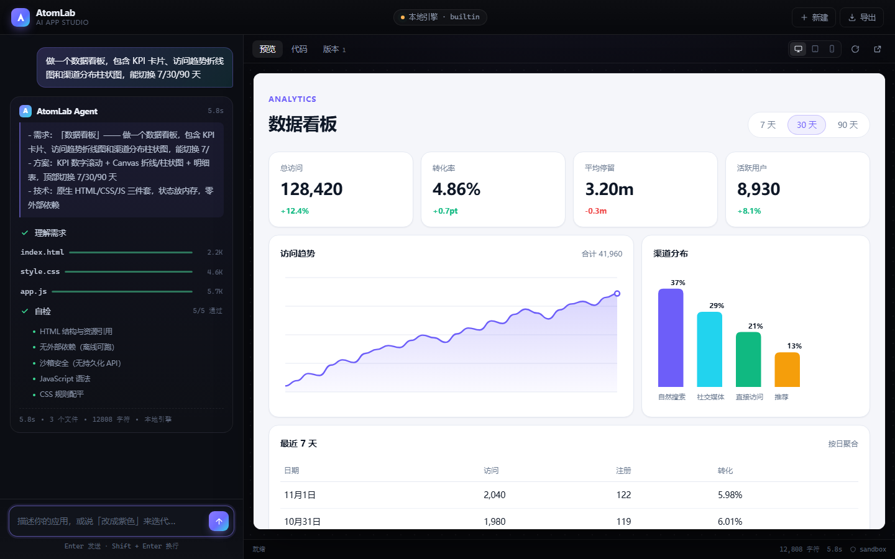

# AtomLab · AI App Studio

> 一个用自然语言驱动、实时生成可运行网页应用的 Agent Demo。
> 左侧对话，右侧沙箱即时渲染；生成过程全透明（计划 → 写码 → 自检）；支持多轮增量修改与版本回滚。



---

## 快速开始

```bash
node server.js          # 零依赖，不需要 npm install
# → http://localhost:4173
```

要求：Node.js ≥ 18。除此之外没有任何依赖、没有构建步骤、不联网也能跑。

```bash
node test/smoke.mjs     # 冒烟测试：8 条生成分支 + 5 条修改分支 + 自检断言
node test/persist.mjs   # 持久化验收：生成 → 刷新 → 应用与版本是否还在
node test/ui-shot.mjs   # 用 CDP 驱动真实 Chrome 跑完整流程并截图（本机需装 Chrome）
```

### 接入真实 LLM（可选）

不配 Key 时走**内置生成引擎**，功能完整；配上 Key 后自动切到模型通道，前端无感：

```bash
OPENAI_API_KEY=sk-xxx node server.js
# 也兼容：DEEPSEEK_API_KEY / LLM_API_KEY
# 可选：OPENAI_BASE_URL（默认 https://api.openai.com/v1）、OPENAI_MODEL（默认 gpt-4o-mini）
```

接口是标准 OpenAI `/chat/completions`，所以 DeepSeek、Moonshot、OpenRouter、vLLM、Ollama 都能直接接。
顶部胶囊会显示当前通道（绿色 = LLM，橙色 = 本地引擎）。

---

## 它到底做了什么

一次生成的可观测链路：

```
用户一句话
   ↓  POST /api/agent（SSE 长连接）
① 理解需求      → 流式吐出一段计划（需求理解 / 方案 / 技术点）
② 写代码        → 逐 token 吐 index.html → style.css → app.js，带字节数与进度
③ 微打包        → 前端把三件套内联成单文档，注入 sandbox iframe（边流边渲染，能看到页面长出来）
④ 自检          → 5 条真实断言，不是装饰
⑤ 落版本        → 快照入版本列表，可回滚
   ↓
继续对话 → 增量修改（只重写被改动的文件）
```

### 自检是真的在检查

| 检查项 | 实现方式 |
|---|---|
| HTML 结构与资源引用 | 断言 `<html>`/`<body>` 存在、正确引用 `style.css` 与 `app.js` |
| 无外部依赖（离线可跑） | 扫描 `src=`/`href=` 是否出现 `http(s)://` |
| 沙箱安全 | 扫描 `localStorage`/`sessionStorage`/`document.cookie` |
| JavaScript 语法 | `new Function(js)` 只编译不执行 |
| CSS 规则配平 | 花括号配平 + 设计系统指纹校验 |

任何一条不通过会在 UI 上显示红色「未通过」——演示时如果模型吐了脏代码，能当场看见。

---

## 架构

```
server.js            零依赖 HTTP：静态托管 + SSE 通道 + 健康检查
lib/llm.js           OpenAI 兼容通道；增量解析模型输出 → agent 事件（含截断容错）
lib/engine.js        本地引擎：意图识别、模板调度、增量补丁、自检
lib/templates.js     8 套应用模板 + 共享设计系统
public/              前端：SSE 消费、微打包、代码高亮、版本管理
test/                smoke.mjs（断言）/ ui-shot.mjs（CDP 实拍）/ shot.mjs、fixtures.mjs
```

### 关键设计取舍

**1. SSE 而不是 WebSocket。** 生成是单向流，SSE 天然适配：纯 HTTP、自带重连语义、不需要握手协议。前端用 `fetch` + `ReadableStream` 手动解析帧，比 `EventSource` 多写 20 行，但不被 GET/无法带 body 限制。

**2. 两条引擎、一套协议。** LLM 通道与本地引擎输出完全相同的 `step / token / file / check / done` 事件，所以「没 Key 就跑不起来」这个 Demo 最常见的死法被绕开了；同时也证明协议层是可替换的。

**3. 三文件真源码，而不是一坨 HTML。** 生成物是 `index.html` + `style.css` + `app.js`（互相用 `<link>`/`<script>` 引用），预览侧由前端做一次「微打包」内联。好处：代码视图能分文件看、导出的是可维护的源码、未来加构建链不用重写。

**4. iframe 不加 `allow-same-origin`。** 于是沙箱里的代码碰不到父页面、碰不到 cookie、碰不到 localStorage。代价是生成的代码不能用持久化 API —— 这条约束同时写进了 LLM 的 system prompt 和本地引擎的自检里，端到端一致。

**5. 本地引擎不假装。** 遇到超出能力的需求（比如「加拖拽排序」），它会明确输出一条边界提示而不是硬生成一个假结果。宁可露怯，也不要把「看起来完成了」当完成。

---

## 内置的 8 套模板

`todo` 任务清单 · `calculator` 计算器（手写递归下降解析器，无 `eval`）· `timer` 番茄钟（环形进度 + WebAudio 提示音）· `dashboard` 数据看板（Canvas 折线/柱状图，跟随主题色）· `form` 预约表单（逐字段校验）· `landing` 产品落地页 · `notes` 记事本 · `generic` 通用兜底

共享一套设计系统（CSS 变量 + 卡片/按钮/输入框原子类），所以任何一个分支生成出来都是成品观感，不是模板拼贴。

增量修改支持：换主题色（10 种）、深色模式、圆角/字号/行高、标题改名。其余需求交给 LLM 通道处理。

---

## 已知限制与下一步

**限制**

- 本地引擎的意图识别是关键词打分，不理解的领域会落到 `generic`。
- 增量修改目前是样式层补丁，结构级改动需要 LLM 通道。
- 版本快照存在内存 + localStorage，刷新页面能恢复，但没有后端数据库。
- 单 HTML 导出：CSS/JS 内联，但没有做 zip 多文件导出。

**下一步优先级**

1. 生成失败自动修复一轮（把自检结果回喂给模型，再生成一次）
2. 代码 diff 视图（当前只标「哪些文件变了」，没做逐行 diff）
3. 项目多开 + 后端持久化
4. 生成时导出 npm 版脚手架（Vite + React），而不只是三件套

---

## 目录里那些 .shots

`.shots/ui-*.png` 是 `test/ui-shot.mjs` 用 Chrome DevTools Protocol 跑真实流程的实拍图（欢迎页 / 生成完成 / 代码视图 / 手机视口 / 修改后 / 版本面板），`dark-*.png` 是深色模式验证图。它们由脚本生成，可以随时删掉重跑。
